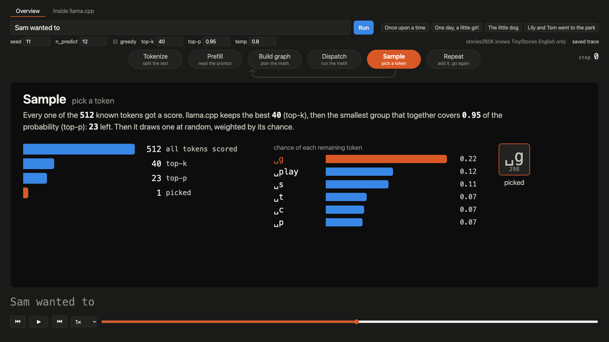
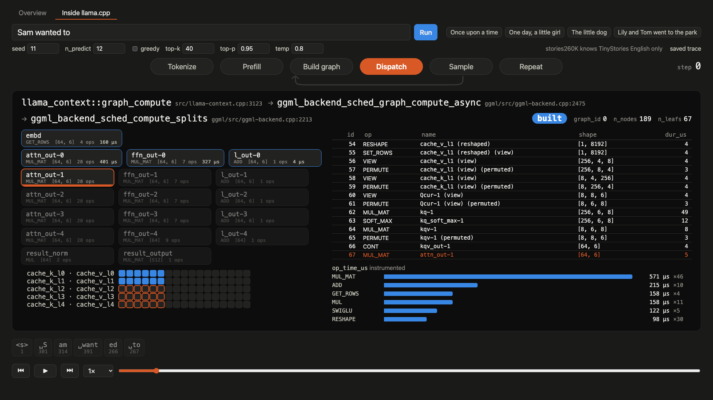

# Inside llama.cpp: Inference Flow Visualizer

A native tracer records one llama.cpp run as newline-delimited JSON events; a web page plays the
trace back stage by stage: tokenize, prefill, build graph, dispatch, sample, repeat. Every number
and label on screen comes from the tracer's events. The browser lays out and animates them.

**Overview**: the six phases in plain language (here, Sample: 512 scored → top-k → top-p → one draw).



**Inside llama.cpp**: the same run at the op and tensor level (here, Dispatch: the scheduler
computing layer 1 attention node by node, with per-op timings and the KV cache filling).



## Pinned llama.cpp

`engine/third_party/llama.cpp` is a git submodule pinned to release tag **b12387**
(commit `a956a852c`, 2026-11-14). llama.cpp is not modified; the tracer uses `llama.h`, the ggml
headers and the `cb_eval` scheduler callback only. Internal tensor names shift between versions:
bump the tag deliberately, rebuild (the build re-reads source locations and fails if a stage
function moved), and rerun every check below.

## Requirements

macOS or Linux with a C++17 compiler, CMake ≥ 3.16, Python 3, git, and Node ≥ 20.
(On macOS: Xcode command line tools, `brew install cmake node`.)

## Build and run

```sh
git clone --recurse-submodules <this repo> llamacpp-inf-flow
cd llamacpp-inf-flow
./scripts/build.sh                                   # tracer + reference examples, CPU backend only
(cd web && npm ci && npx playwright install chromium)
(cd web && npx vite)                                 # http://localhost:5173
```

`models/stories260K.gguf` is committed. To fetch it again (SHA-256 checked):
`./scripts/fetch-model.sh` (from `ggml-org/models-moved`, `tinyllamas` folder).

The page has two tabs on the same trace:

- **Overview**: the six phases in plain language for an audience that does not know transformer
  internals (open directly with `/?view=overview`). One caption per phase; every number in the
  captions and every visual comes from the trace. Captions live in `web/src/overview/OverviewViews.tsx`.
- **Inside llama.cpp**: the technical view below, labelled only with llama.cpp function, op and
  tensor names.

In the page:

- Type a prompt or pick a preset and press **Run**: the dev server runs the tracer once
  (`POST /api/trace`) and the page plays the new trace. Seed, `n_predict`, greedy, top-k, top-p
  and temp are tracer settings; changing a sampler knob reruns with the same seed.
- **Transport**: space play/pause, ← → step, ↑ ↓ change stage, scrubber, speed.
  Click a rail chip to jump to that stage, an output token to jump to the step that produced it.
- **Build graph / Dispatch**: click a block to expand its layer into the real ggml ops (elkjs);
  hover a node for its name, op, shape and the source line that named it.
- **Sample**: *fork* on any candidate reruns the tracer with `--force`, taking that token instead.
- Hover a generated token for its attention (`kq_soft_max-N`, all heads, all layers).
- Press **r** for **Record mode** of the current tab (or open `/?record=1`, `/?record=1&view=overview`):
  fixed 1920×1080, no settings or transport, playing the saved trace so every take is identical.
  About 50 s for Inside llama.cpp, about 70 s for Overview. Esc leaves it.

## Record mode

The run (prompt, seed, token count) and every stage duration live in
`web/src/record/script.ts`. Record mode plays `web/public/demo-trace.jsonl` and refuses to start
if that trace's settings differ from the script. Regenerate the trace after changing the run:

```sh
./scripts/make-fixture.sh        # runs the tracer with RECORD_RUN from script.ts, validates the output
```

Current run: "Sam wanted to", seed 11, 12 tokens → " go to the park with his friends."

## Tracer

```sh
engine/build/bin/tracer --model models/stories260K.gguf --prompt "Once upon a time" \
  --seed 1 --n-predict 12 > trace.jsonl
#   --greedy | --top-k 40 --top-p 0.95 --temp 0.8     sampler stages (applied one by one)
#   --ctx-size N            default n_prompt + n_predict
#   --capture a,b,...       tensors shipped in full (default kq_soft_max,l_out,result_output)
#   --force id,id,...       take these tokens at steps 0..n-1 (fork)
#   --verbose               llama.cpp logs on stderr
#   LLAMA_GRAPH_REUSE_DISABLE=1   force a graph rebuild every step
node scripts/validate-trace.mjs trace.jsonl    # JSON Schema + ordering invariants
```

The event schema is `web/src/trace/schema.ts`; `web/src/trace/trace.schema.json` is generated
from it (`cd web && npm run schema`). Timings are instrumented (the scheduler computes one node at
a time so each can be observed); compare them with each other, not with benchmarks.

## Checks

```sh
./scripts/check-phase0.sh                          # llama-eval-callback prints kq_soft_max-0, result_output
python3 -I scripts/check-phase1.py                 # schema; greedy ids == examples/simple; stable graphs
(cd web && npx playwright test tests/phase2.spec.ts)   # saved trace plays; data from trace; exact step-back
(cd web && npx playwright test tests/phase3.spec.ts)   # live trace < 1 s, ids == direct CLI run; fork; errors
(cd web && npx playwright test tests/overview.spec.ts) # Overview tab: plays; trace numbers in every phase; exact step-back
(cd web && npx playwright test tests/record.spec.ts)   # Record mode, both tabs: every panel non-empty, within budget
(cd web && npx playwright test)                        # all web checks
```

`RECORD_OUT=<dir> npx playwright test tests/record.spec.ts` also writes per-stage screenshots and a
1920×1080 `.webm` of each pass. The tests start their own dev server on port 5174 and never reuse
a running one.

## Layout

- `engine/` tracer (`tracer.cpp`), CMake, `ref/simple_ids.cpp` (examples/simple + one line
  printing ids, for the Phase 1 check), `third_party/llama.cpp`
- `web/` Vite + React + TypeScript app: `src/trace/` schema, parser, timeline, player;
  `src/stages/` one view per stage; `src/ui/` frame; `src/record/script.ts`; `tests/`;
  `vite-plugin-tracer.ts` (dev-server bridge)
- `web/public/demo-trace.jsonl` saved trace (UI fixture and Record mode)
- `models/` GGUF file; `scripts/` build, fetch, fixture, source-location and check scripts
